  
   
  

<h3 align="left">
  Olá! Sou Maria Gabriela, estudante de Tecnologia em Sistemas de Computação pela UFF e desenvolvedora Front-end Jr. Sigo na minha carreira fazendo cursos de Redes e Back-end para o meu melhor desenvolvimento profissional.
    
  Seja bem-vindo! Esses são os meus projetos e pretendo melhorá-los cada vez mais para me tornar uma desenvolvedora Pleno.
</h3>
 

  

 

<table>
  <tr align="center">
    <td width="100"> <b>HTML</b></td>
    <td width="100"> <b>CSS</b></td>
    <td width="100"> <b>JavaScript</b></td>
    <td width="100"> <b>GitHub</b></td>
  </tr>
  <tr align="center">
    <td width="100"> <b>Git</b></td>
    <td width="100"> <b>Python</b></td>
    <td width="100"> <b>React</b></td>
    <td width="100"> <b>MySQL</b></td>
  </tr>
</table>

  
  

<picture>
  <source media="(prefers-color-scheme: dark)" srcset="https://raw.githubusercontent.com/Gabislkx/Gabislkx/output/github-snake.svg">
  <source media="(prefers-color-scheme: light)" srcset="https://raw.githubusercontent.com/Gabislkx/Gabislkx/output/github-snake.svg">
  
</picture>

 

